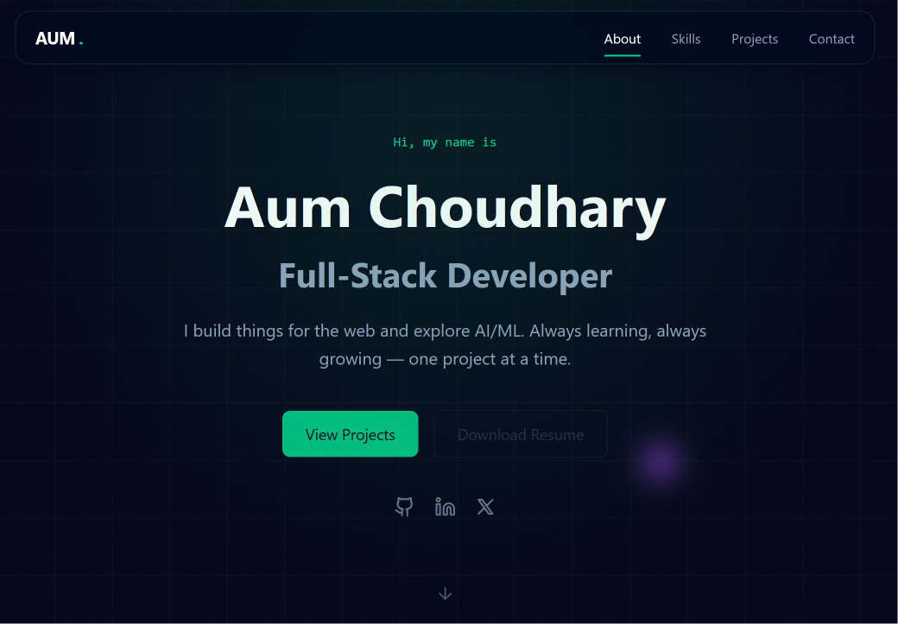

# Aum Choudhary — Developer Portfolio

A personal developer portfolio website: clean, modern, and dark-first. Built with React, Vite, and Tailwind CSS, with motion powered by Framer Motion.

### 🔗 Live Site: [aummdev.vercel.app](https://aummdev.vercel.app/)

## Preview



## Tech Stack

- **React 19 + Vite** — fast dev server and optimized production builds
- **Tailwind CSS v4** — utility-first styling
- **Framer Motion** — hero entrance, section reveals, hover and nav transitions (respects `prefers-reduced-motion`)
- **Lucide React** — icons

## Features

- **Hero** — intro, CTAs, and social links
- **About** — background, interests, and technologies
- **Skills** — categorized chips (no percentage bars)
- **Projects** — reusable cards with tech tags, repo/demo links, and a featured flag
- **Experience / Education / Achievements** — timeline-style sections
- **Contact** — direct links (email, GitHub, LinkedIn), no backend form
- Responsive layout, keyboard accessible, and fast with minimal dependencies

## Project Structure

```
src/
├── components/   # Reusable UI components
├── data/         # projects, skills, personal, achievements data
├── assets/
├── App.jsx
├── main.jsx
└── index.css
```

All content lives in `src/data/` as plain JS, so personal details can be swapped for API calls later without touching the UI components.
